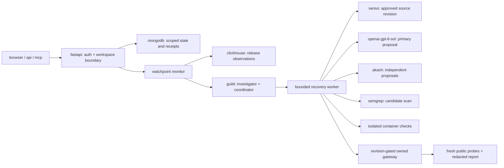

# architecture and safety boundary

oopsie is a narrow recovery agent for an owned, synthetic multi-tenant billing api. its failure mode is a successful http response whose contents violate the current contract. a green uptime check misses both a 100× invoice amount and a cross-tenant invoice read. the first release creates one isolated service per workspace; public github, cve, and verified-url watches are read-only and do not become deployment targets.

guild hosts the reasoning team and returns structured investigation and coordination decisions. the deterministic worker alone owns the deployment action; the hosted agents have no arbitrary shell or external deployment credential. the worker records a lease and compares the current service revision, faulty artifact, policy version, and frozen floor before switching to the exact candidate it tested. a failed vendor call, inconclusive test, changed source revision, or uncertain action ends at `needs attention`.

[`demo-app/checks.py`](../demo-app/checks.py) is the executable floor. its five cases require an amount/schema-correct tenant a response, a positive tenant b response, cross-tenant denial, anonymous denial, and unknown-invoice denial. checking positive reads prevents a deny-all handler from passing. models cannot edit the expected data or checks. proposals must pass the constrained pure-handler source shape, [`demo-app/semgrep.yml`](../demo-app/semgrep.yml), and independent container execution with no candidate network, read-only root, dropped capabilities, and resource limits. a passing local candidate is still only a proposal until the live gateway switch and two fresh public probe rounds pass.

the synthetic security injection is [`unsafe_ai_fix.py`](../demo-app/releases/unsafe_ai_fix.py): it resembles an ai-style amount fix but omits the tenant guard. it is **not** recorded model output. the `legacy` rollback also leaks across tenants; `prior` uses the retired `amount` field. the selected showcase repair matched the known healthy handler. the evidence demonstrates a real bounded recovery action and rejection gate, not general code repair or a newly invented patch.

the separate [`security-demo/`](../security-demo/) reproduces [cve-2025-29927](https://github.com/vercel/next.js/security/advisories/GHSA-f82v-jwr5-mffw) on our own synthetic next.js 14.2.24 lab and compares it with 14.2.25. it is not the billing target and was not an attack on a third party. its deliberately vulnerable port must remain loopback-only.

the browser, api, and 18 mcp tools use workspace-scoped sessions or bearer keys. raw keys are displayed once, stored by hash, and never appear in public reports. clickhouse observations omit invoice bodies and demo tokens. generated source and lab containers do not receive vendor keys or host networking. public reports project an allowlisted, redacted event set and include a recomputable sha256 chain. that chain detects later edits only if its head was saved independently; it is not a signature or proof that the underlying events were true.

the [tenant-boundary report](https://oopsie.website/status/3177f589d3234e399a574a1920753ef2) shows the public result. private incident downloads carry more detail, including source and vendor request identifiers, and remain authenticated. deploy and environment templates are in [`deploy/`](../deploy/) and [the reproduction guide](reproduce.md).
